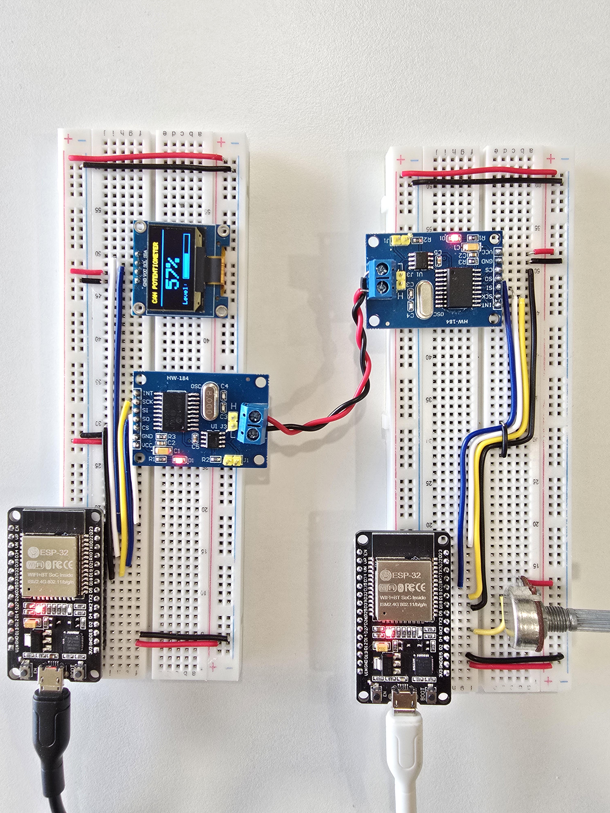

# ESP32 CAN Bus Speed Simulator (Potentiometer → CAN → OLED)

Two ESP32 boards talk to each other over a **CAN bus** using **MCP2515 (HW-184)** CAN controller modules.
A potentiometer on the **transmitter node** simulates a vehicle speed / throttle value (0–100 %). The value is sent
as a CAN frame every 500 ms and shown on a **128×64 SSD1306 OLED** on the **receiver node**, which also answers with
an **ACK frame**. If the ACK is missing, the transmitter retries up to 3 times.



> Add your breadboard photo as `images/setup.jpg`.

---

## Features

- CAN bus at **500 kbit/s** between two ESP32 nodes
- 12-bit ADC reading mapped to **0–100 %** (speed simulation)
- Application-level **ACK + retry** (3 attempts, 300 ms ACK timeout)
- OLED dashboard: large percentage value + progress bar
- Serial debug output on both nodes (115200 baud)

## Hardware

| Qty | Part |
|----|------|
| 2 | ESP32 DevKit (ESP-WROOM-32, 30-pin) |
| 2 | MCP2515 CAN module (HW-184, TJA1050 transceiver, 8 MHz crystal) |
| 1 | 10 kΩ potentiometer (transmitter) |
| 1 | SSD1306 0.96" 128×64 I²C OLED, address `0x3C` (receiver) |
| 2 | Breadboards + jumper wires |
| 2 | Micro-USB cables |
| 2 | Twisted pair wire for CAN H / CAN L |

## Wiring

### Transmitter node (ESP32 #1)

| MCP2515 (HW-184) | ESP32 |
|------------------|-------|
| VCC | 5V (VIN) |
| GND | GND |
| CS | GPIO 5 |
| SCK | GPIO 18 |
| SI (MOSI) | GPIO 23 |
| SO (MISO) | GPIO 19 |
| INT | not used |

| Potentiometer | ESP32 |
|---------------|-------|
| Pin 1 | 3V3 |
| Wiper (middle) | GPIO 4 |
| Pin 3 | GND |

### Receiver node (ESP32 #2)

| MCP2515 (HW-184) | ESP32 |
|------------------|-------|
| VCC | 5V (VIN) |
| GND | GND |
| CS | GPIO 5 |
| SCK | GPIO 18 |
| SI (MOSI) | GPIO 23 |
| SO (MISO) | GPIO 19 |
| INT | not used |

| SSD1306 OLED | ESP32 |
|--------------|-------|
| GND | GND |
| VCC | 3V3 |
| SCL | GPIO 22 |
| SDA | GPIO 21 |

### CAN bus connection

```
 MCP2515 #1                 MCP2515 #2
  [ H ]  ──────────────────  [ H ]
  [ L ]  ──────────────────  [ L ]   (twisted pair)
```

- Connect **H to H** and **L to L** (the screw terminal on each module). Swapping them is the most common reason for "no ACK".
- Keep the **120 Ω termination jumper (J1)** fitted on **both** modules (each end of the bus is terminated).
- Both ESP32 and MCP2515 grounds should be common to their own breadboard; the CAN pair needs no shared ground for a short bench setup.

> **Note on voltage:** HW-184 modules are 5 V parts, so the MCP2515 `SO` pin outputs 5 V logic. The ESP32 GPIOs are
> 3.3 V only. It works on many benches, but for a robust build add a level shifter (or a resistor divider on `SO`).

## CAN message format

| Frame | ID | DLC | Data | Direction |
|-------|----|-----|------|-----------|
| Speed data | `0x036` | 2 | `[0]` = high byte, `[1]` = low byte of percentage (0–100) | TX → RX |
| ACK | `0x037` | 0 | none | RX → TX |

Standard 11-bit identifiers, 500 kbit/s, MCP2515 crystal 8 MHz.

### Turning the percentage into a speed

The percentage is the "speed". To show real units, scale it on the receiver, for example:

```cpp
const int MAX_SPEED_KMH = 200;
int speedKmh = (percentage * MAX_SPEED_KMH) / 100;
```

## Software setup

1. Install the **Arduino IDE** and the **ESP32 board package** (Espressif).
2. Install the required libraries:
   - **MCP2515** by autowp (provides `mcp2515.h`), see the steps below
   - `Adafruit GFX Library` (Library Manager)
   - `Adafruit SSD1306` (Library Manager)
3. Select board **ESP32 Dev Module**.
4. Flash [`can_transmitter.ino`](TransmitterMCP.ino) to ESP32 #1 and [`can_receiver.ino`](ReceiverMCP.ino) to ESP32 #2 (each in its own sketch folder).
5. Open the Serial Monitor at **115200 baud** on each board.

### Installing the MCP2515 library (autowp)

| | |
|---|---|
| Library name | `MCP2515` |
| Author | autowp |
| Header file | `mcp2515.h` |
| GitHub | [arduino-mcp2515 repository](https://github.com/autowp/arduino-mcp2515) |

1. Open Arduino IDE.
2. Go to **Sketch → Include Library → Manage Libraries**.
3. Search for `MCP2515`.
4. If it doesn't appear, download the ZIP from the GitHub repository.
5. Select **Sketch → Include Library → Add .ZIP Library**.
6. Restart Arduino IDE.

## Expected output

Transmitter:
```
Potentiometer CAN transmitter started
Potentiometer: 2341 | Sending: 57%
ACK received
```

Receiver:
```
CAN Receiver Ready
Received Percentage: 57%
ACK sent
```

The OLED shows `CAN POTENTIOMETER`, the percentage in large digits and a level bar.

## Troubleshooting

| Problem | Likely cause / fix |
|---------|--------------------|
| `ACK not received` repeatedly | CAN H/L swapped, missing termination jumper, or receiver not powered |
| No CAN communication at all | Bitrate/crystal mismatch: modules are 8 MHz, code uses `MCP_8MHZ` (use `MCP_16MHZ` if your crystal says 16.000) |
| OLED blank | Check I²C address (`0x3C` vs `0x3D`) and SDA/SCL wiring |
| Value jumps around | Add a 100 nF capacitor on the wiper or average several ADC samples |
| Wrong readings on GPIO 4 | GPIO 4 is ADC2; it cannot be used while Wi-Fi is on (fine here, Wi-Fi is unused) |
| MCP2515 init fails | Check 5 V supply and the CS pin (GPIO 5) |


## License

MIT
